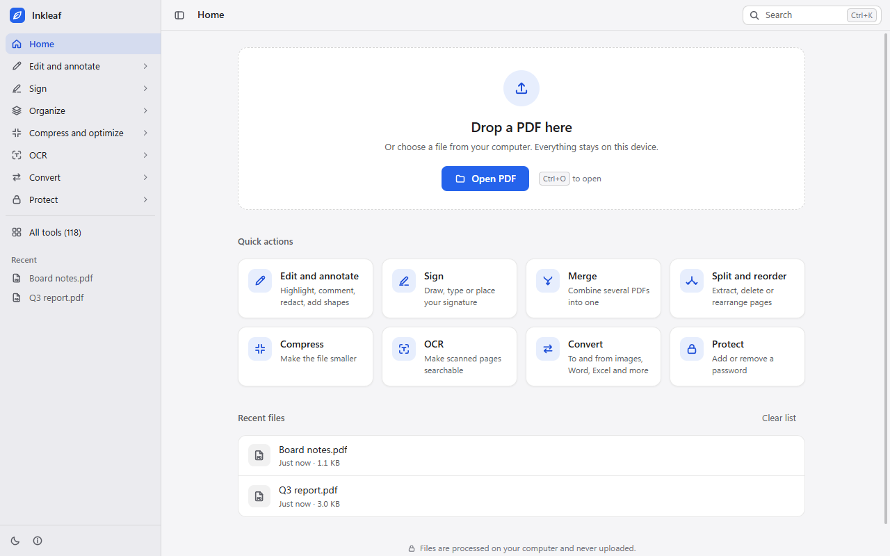
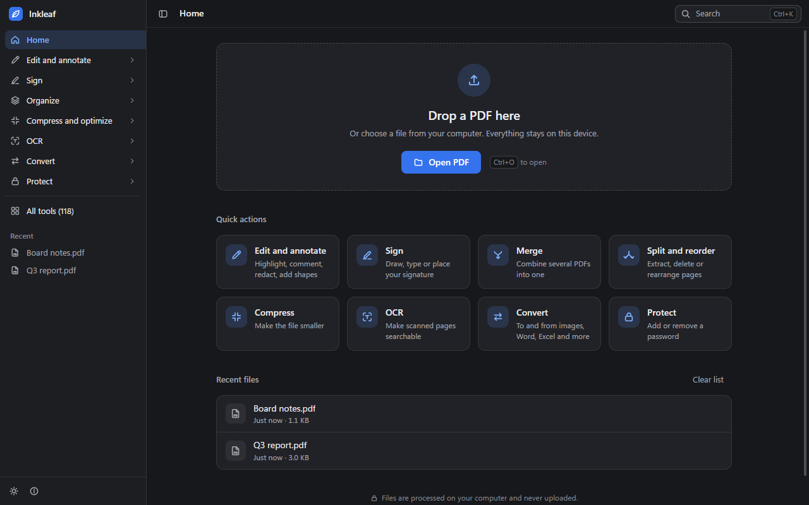
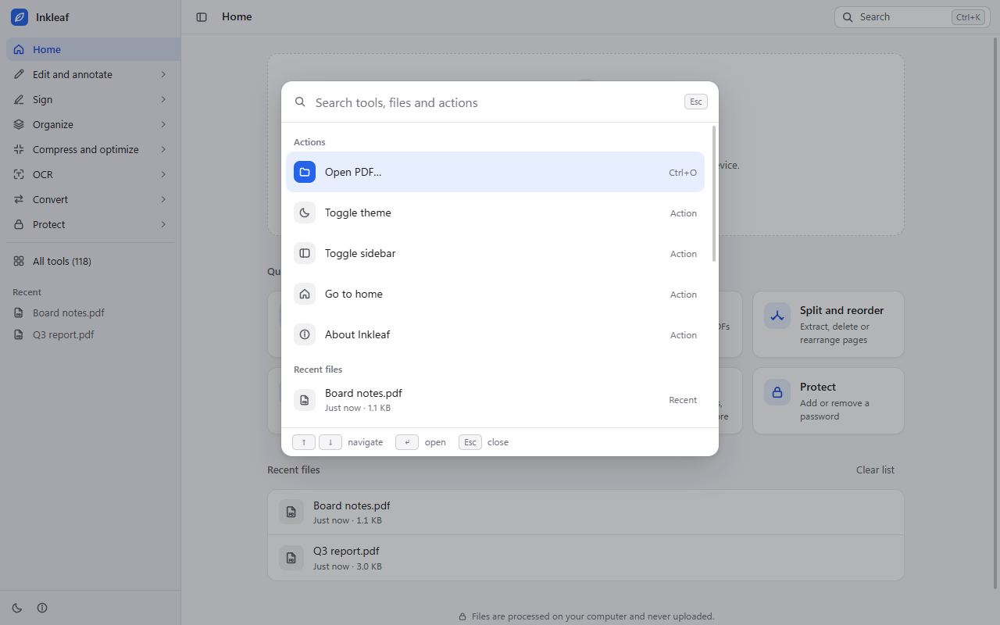
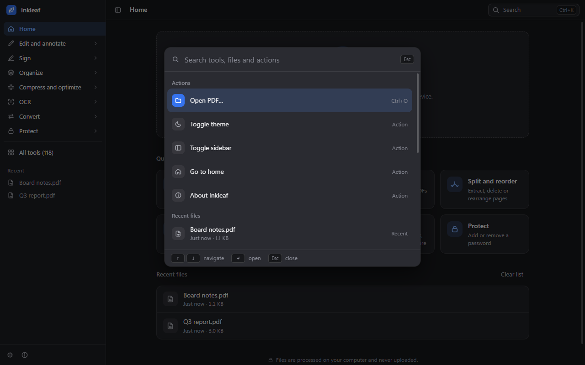
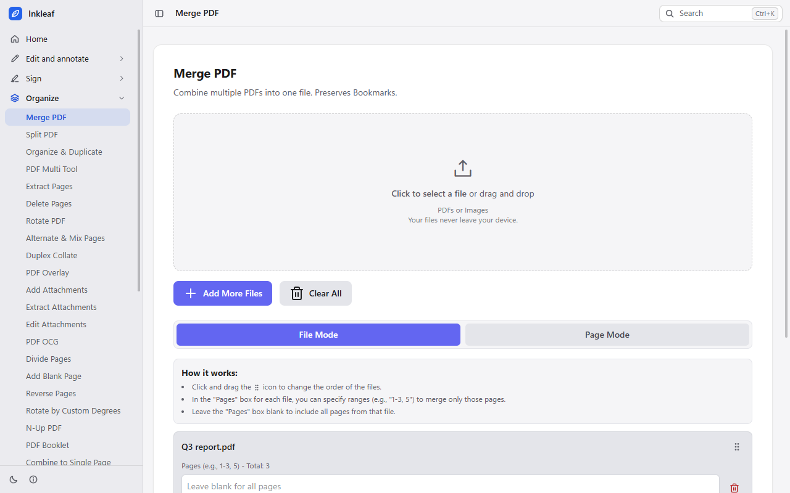
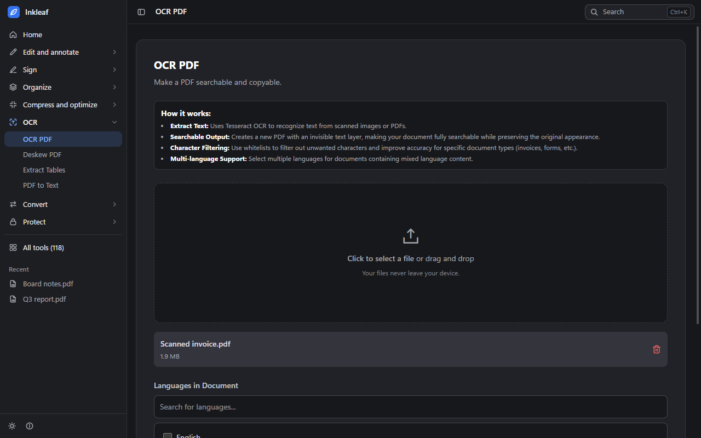
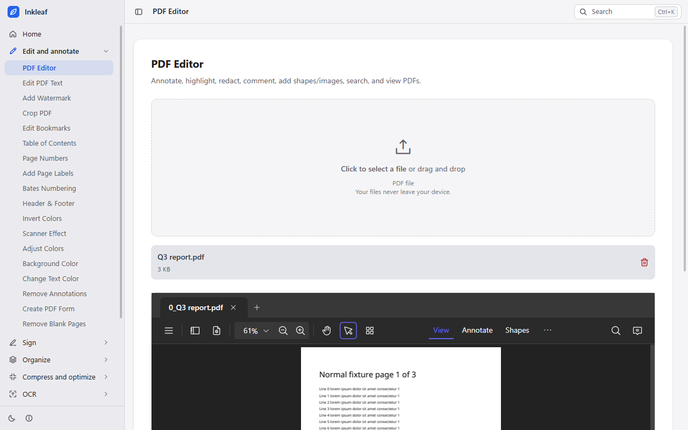
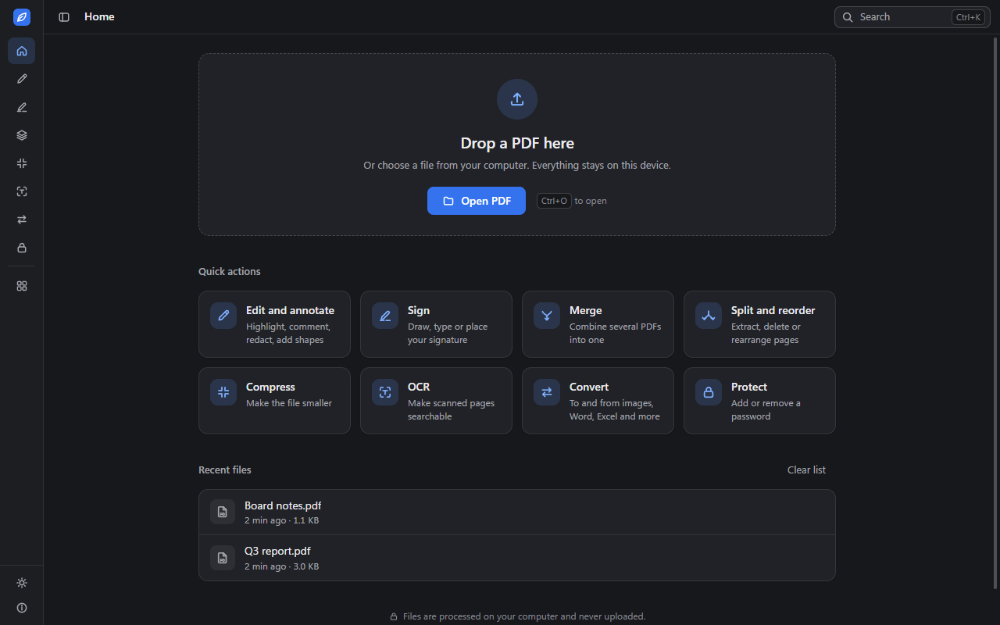

# Inkleaf

**A free, open-source desktop PDF toolkit for Windows and macOS.** It works fully offline, with no telemetry,
no accounts and no cloud. A free alternative to paid PDF editors.

Inkleaf bundles **118 PDF tools** (merge, split, edit, annotate, convert, OCR, compress, repair, sign, protect and
more) into one app. Your files stay on your computer.

> Status: early desktop release (version 2.8.11). The Windows installer builds locally; macOS builds are produced by
> CI and have not been tested on real hardware by the author. See [Known limitations](#known-limitations).

## Screenshots

| Home (light)                                                        | Home (dark)                                                                           | Command palette (light)                                               |
| ------------------------------------------------------------------- | ------------------------------------------------------------------------------------- | --------------------------------------------------------------------- |
|        |                            |  |
| **Command palette (dark)**                                          | **Merge PDF**                                                                         | **OCR PDF (dark)**                                                    |
|  |                  |          |
| **PDF Editor (light)**                                              | **Sidebar collapsed (dark)**                                                          |                                                                       |
|  |  |                                                                       |

## Features

Inkleaf has 118 distinct tool pages in 7 categories (`docs-desktop/stats.json`). Some tools appear in more than one
category.

- **Popular tools** (13): Edit PDF Text, PDF Workflow Builder, PDF Multi Tool, Merge, Split, Compress, PDF Editor,
  JPG to PDF, Sign, Crop, Extract Pages, Duplicate & Organize, Delete Pages.
- **Edit & annotate** (21): annotate, highlight, redact, comments and shapes; bookmarks; table of contents; page
  numbers and labels; Bates numbering; watermarks; headers and footers; colour adjustments; stamps; form filler and
  form creator; blank-page removal.
- **Convert to PDF** (33): images (JPG, PNG, WebP, SVG, BMP, TIFF, HEIC, PSD and more), text, Markdown, JSON, CSV,
  RTF, XML, Word and OpenDocument text, spreadsheets and presentations, e-books (EPUB, MOBI, FB2, CBZ), email (EML, MSG),
  and more.
- **Convert from PDF** (16): JPG, PNG, WebP, BMP, TIFF, SVG, CBZ; CSV, Excel, JSON, Markdown and text; Word; image
  extraction; content export for AI and RAG pipelines (LlamaIndex JSON).
- **Organize & manage** (28): merge (including alternate and mixed page order), split, divide, reorder, reverse,
  rotate, N-up, booklet, combine to a single page, OCG layers, attachments, metadata, table extraction, compare PDFs.
- **Optimize & repair** (10): compress, PDF/A conversion, rasterize, deskew (OpenCV), font to outline, page size and
  dimensions, linearize, repair damaged files, remove restrictions on signed files.
- **Secure PDF** (9): password protection, unlock, sanitize, flatten, metadata removal, permissions, digital
  signatures with X.509 certificates, signature validation, RFC 3161 timestamps.

The full list, grouped by category, is in [`docs-desktop/FEATURES.md`](docs-desktop/FEATURES.md).

OCR runs locally with Tesseract, and the offline assets (WebAssembly engines, OCR data, fonts) are bundled with the app.

## Privacy

Inkleaf does not send your files or usage data anywhere.

- **Nothing leaves the machine by default.** No telemetry, no analytics, no crash reporting, no accounts and no cloud
  storage. The UI states it plainly: "Your files never leave your device."
- The app's network rules allow only the app's own local resources. Other requests from the window are blocked.
- **Two opt-in actions** can use the network, and each one asks first:
  1. **Timestamp PDF**: sends a timestamp request to an RFC 3161 time server you pick from the list, after you confirm.
  2. **Office conversion add-on**: an optional, one-time LibreOffice add-on download, after you confirm its size and
     source. It is not downloaded otherwise.
- Opening an `http(s)` link from inside the app asks before it opens your browser.

## Install

1. Go to the releases page: **https://github.com/cod1nz/Inkleaf/releases** (placeholder until the
   repository is public).
2. Download the file for your system:
   - Windows: `Inkleaf-Setup-<version>-x64.exe` (installer) or the portable build, if one is attached.
   - macOS: `Inkleaf-<version>-<arch>.dmg`.
3. Compare the SHA-256 checksum with `SHA256SUMS.txt` in the same release.
4. Open the file. Builds without a code-signing certificate are not trusted by Windows SmartScreen or macOS
   Gatekeeper, so you will see a warning. How to open an unsigned build is explained in
   [`docs-desktop/BUILDING.md`](docs-desktop/BUILDING.md#unsigned-builds-what-users-will-see).

Inkleaf is not auto-updating. Download a new release to update.

## Keyboard shortcuts

On macOS, use Cmd where this table says Ctrl.

| Shortcut     | Action                                                           |
| ------------ | ---------------------------------------------------------------- |
| Ctrl+K       | Open the command palette: search tools, recent files and actions |
| Ctrl+O       | Open a PDF                                                       |
| Ctrl+Shift+S | Save a copy                                                      |
| Ctrl+\\      | Show or hide the sidebar                                         |
| Ctrl+Shift+D | Toggle dark mode                                                 |

In the command palette: arrow keys move, Enter opens, Esc closes, Ctrl+Home and Ctrl+End jump to the first and last
item. Zoom and standard edit shortcuts come from the View and Edit menus.

## Build from source

Requirements: Node.js 22 (CI pins 22), npm, and a Windows or macOS host for installers.

```sh
npm ci                  # install dependencies
npm run desktop:assets  # fetch and verify offline wasm, OCR and font assets (pinned SHA-256)
npm run build:desktop   # build the offline web bundle into dist/
npm run desktop:start   # run the app: electron .

npm run dist:win        # Windows installers in release/
npm run dist:mac        # macOS dmg files in release/ (run build:desktop first on macOS)

npx vitest run                              # unit tests
node --test "electron/__tests__/*.test.js"  # Electron shell tests
npx eslint electron                         # lint the shell
```

Development with live reload: run `npm run dev` in one terminal, then `npm run desktop:dev` in another.

More detail, including what each script does, signing secrets and the CI workflow, is in
[`docs-desktop/BUILDING.md`](docs-desktop/BUILDING.md).

## Project layout

| Path                             | Contents                                                                                                                                                                                                                                                           |
| -------------------------------- | ------------------------------------------------------------------------------------------------------------------------------------------------------------------------------------------------------------------------------------------------------------------ |
| `electron/`                      | Electron main process: window and hardening (`main.js`), `app://` protocol (`protocol.js`), IPC (`ipc.js`), native menu (`menu.js`), file, path and MIME helpers (`lib/`), add-on installer (`addons/`), timestamp client (`net/`). Plain CommonJS, no build step. |
| `src/desktop/`                   | Renderer code for the desktop shell: home, command palette, sidebar, theme, recent files, file handoff to tools.                                                                                                                                                   |
| `src/js/config/tools.ts`         | The single list of tools, shared by the web app and the desktop app.                                                                                                                                                                                               |
| `vite-plugins/desktop-chrome.ts` | Injects the desktop chrome into each page when `DESKTOP=true`.                                                                                                                                                                                                     |
| `scripts/`                       | Build helpers, including `desktop-assets.mjs` (offline assets), `gen-notices.mjs` (third-party notices) and `collect-stats.mjs` (project statistics).                                                                                                              |
| `e2e/`                           | Electron end-to-end suites (`suites/`), fixtures, and recorded results (`results.json`).                                                                                                                                                                           |
| `build/`                         | Icons and macOS entitlements used by electron-builder.                                                                                                                                                                                                             |
| `docs-desktop/`                  | Desktop documentation, screenshots and statistics.                                                                                                                                                                                                                 |
| `dist/`, `release/`              | Build output and installers (generated, not committed).                                                                                                                                                                                                            |
| `UPSTREAM-README.md`             | The original BentoPDF README, kept unchanged for reference.                                                                                                                                                                                                        |

## Security model

1. The renderer runs sandboxed, with context isolation and without Node integration. Webviews are disabled.
2. The preload script exposes one narrow API, `window.desk`. The renderer never receives file system paths.
3. Files are read only when the user chooses them (dialog, open-with, drag and drop). The main process keeps a map of
   file ids to paths and checks every request against it.
4. Saves go only to a location the user picked in the save dialog, written atomically (temporary file, then rename).
5. Every IPC handler checks that the request comes from the top-level frame of a trusted app page.
6. Navigation is locked to `app://bentopdf/`. Pop-ups and new windows are denied. Permission requests (camera,
   microphone, notifications, devices) are all refused.
7. A strict content security policy applies (`default-src 'self'`, no `object-src`, no remote connections). A session
   filter blocks any request that is not an app, blob, data or devtools URL.
8. Downloaded add-ons are checked against a pinned SHA-256 before use. Timestamp servers come from a fixed allow-list.

The reasoning and the file-by-file detail are in [`electron/README.md`](electron/README.md).

## Known limitations

- **English only.** The desktop UI is English. The `dist/` build includes 24 locale data folders, but no translated
  pages.
- **Office conversion needs a one-time add-on download.** The LibreOffice-based converter is downloaded after you
  confirm, and only once the add-on is published. Until then, those conversions are not available.
- **macOS builds are unsigned, and the author has not tested them on real Mac hardware.** Expect Gatekeeper warnings.
  CI can sign and notarize if the secrets are configured. See [`docs-desktop/BUILDING.md`](docs-desktop/BUILDING.md).
- **Windows builds are unsigned unless the signing secret is set.** Expect a SmartScreen warning.
- **Large-file merge limits.** Very large inputs can run out of memory in the window. The recorded end-to-end run
  shows a failure with a merge of about 216 MB. See `docs-desktop/FEATURES.md`.
- **Installer size.** The Windows installer is about 210 MB, because it includes the Electron runtime and the
  bundled WebAssembly, OCR and font assets.

## License and credits

Based on BentoPDF by alam00000 (https://github.com/alam00000/bentopdf), licensed under AGPL-3.0. Inkleaf is free
software under the GNU AGPL-3.0; source code available at the repository linked above. See [LICENSE](LICENSE) and
[Third-party notices](public/third-party-notices.html).

The third-party notices list 413 JavaScript packages and 14 bundled components (WebAssembly and native), with their
licences. The original BentoPDF README is in [`UPSTREAM-README.md`](UPSTREAM-README.md).

Repository: `https://github.com/cod1nz/Inkleaf` (placeholder).
